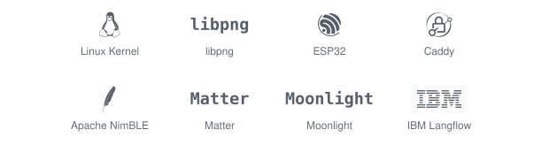

<h1 align="center">하태구</h1>

  커널·임베디드 시스템·애플리케이션을 파고들어 취약점을 찾습니다. 
  연구 도구를 직접 만들고, 발견한 취약점을 실제 동작하는 익스플로잇으로 구현하며, 업스트림 수정에 기여합니다.

<!-- security-contribution-logos:start -->

  <strong>보안 기여자</strong> 
  <picture>
    <source media="(max-width: 767px) and (prefers-color-scheme: dark)" srcset="./assets/brands/contributors-mobile-dark.svg">
    <source media="(max-width: 767px)" srcset="./assets/brands/contributors-mobile-light.svg">
    <source media="(prefers-color-scheme: dark)" srcset="./assets/brands/contributors-desktop-dark.svg">
    
  </picture>

  <strong>취약점이 패치된 제품</strong> 
  <picture>
    <source media="(max-width: 767px) and (prefers-color-scheme: dark)" srcset="./assets/brands/patched-mobile-dark.svg">
    <source media="(max-width: 767px)" srcset="./assets/brands/patched-mobile-light.svg">
    <source media="(prefers-color-scheme: dark)" srcset="./assets/brands/patched-desktop-dark.svg">
    
  </picture>

<!-- security-contribution-logos:end -->

  <a href="mailto:hataegu0826@gmail.com">Email</a> ·
  <a href="https://github.com/foxirain/CVE-public">CVE 기록</a> ·
  <a href="https://dreamhack.io/users/71306">Dreamhack</a> ·
  <a href="./README.md">English</a>

업스트림 크레딧 표기: Taegu Ha · foxirain · Amemoyoi

## Experience

- **강원대학교 CASO Lab** · 학부 연구 인턴  
  Galaxy Watch5 센서 드라이버·SensorHub 펌웨어 역분석 (GW5). AVB 해시 검증 도구와 펌웨어 실험용 유선 연결·충전 장비 제작  
  2024.05 – 2025.01
- **한국정보기술연구원(KITRI) 화이트햇 스쿨** · 2기 수료  
  팀 프로젝트 WhiteGang에서 Windows 프로세스 보호 드라이버 개발  
  2024.03 – 2024.09
- **st3p_up** · CTF 팀  
  강원지역 사이버보안 해킹방어대회(GCHD)·CO-SHOW AutoHack에서 Pwnable·하드웨어 보안 담당, 3년 연속 수상  
  2024 – 현재
- **Tryangle** · AI·백엔드 개발  
  장면 이해 모델 실험·평가, 서버 개발과 운영 배포, 인증·권한 등 API 보안  
  2026.07 – 현재
- **외주 개발** · 심리학과 연구실 의뢰  
  112채널 LED 제어 시스템 설계·제작·납품. 하드웨어, Raspberry Pi 5 제어 소프트웨어, 19페이지 운영 매뉴얼 제공  
  2025.01 – 2025.02

## Highlights

### 취약점 연구

- **Linux kernel** · USB UAC1, PPP, BPF verifier의 오류를 수정한 **패치 3건을 직접 작성해 Linux mainline에 반영**.  
  UAC1·PPP 수정(**CVE-2026-31720**, **CVE-2026-53075**)은 각각 안정 커널 7개 계열에 백포트됐고 Ubuntu·Debian·SUSE 보안 업데이트로 배포. PPP 수정은 Red Hat Enterprise Linux 8–10에도 배포.  
  USB UAC1 후속 연구에서 **CVE-2026-31720**과 CVE-2026-31513을 결합한 익스플로잇을 개발. x86-64 QEMU/KVM 환경에서 **SSP·KASLR을 우회하고 root 권한 명령 실행**을 입증.  
  [UAC1](https://git.kernel.org/pub/scm/linux/kernel/git/torvalds/linux.git/commit/?id=6e0e34d85cd46ceb37d16054e97a373a32770f6c) · [PPP](https://git.kernel.org/pub/scm/linux/kernel/git/torvalds/linux.git/commit/?id=2bb6379416fd19f44c3423a00bfd8626259f6067) · [BPF](https://git.kernel.org/pub/scm/linux/kernel/git/torvalds/linux.git/commit/?id=de36adca634634c205a9eb8b56a28175ab7abf5f) · [Ubuntu](https://ubuntu.com/security/CVE-2026-53075) · [Debian](https://security-tracker.debian.org/tracker/CVE-2026-53075) · [Red Hat](https://access.redhat.com/security/cve/CVE-2026-53075) · [익스플로잇 보고서](https://github.com/foxirain/CVE-public/tree/main/cases/CVE-2026-31720/exploit)
- **libpng** · **CVE-2026-33636** 취약점 발견. Google의 Android 보안 공지에서 **Critical**로 분류.  
  공동 작성한 보안 패치가 **libpng 1.6.56**과 **Google AOSP·Ubuntu·Debian·Red Hat·Firefox**에 반영됐으며, **Oracle JDK·Samsung Galaxy** 업데이트에도 포함. libpng 공식 **AUTHORS**에 기여자로 등재.  
  [CVE-2026-33636](https://github.com/foxirain/CVE-public/tree/main/cases/CVE-2026-33636) · [libpng](https://github.com/pnggroup/libpng/commit/aba9f18eba870d14fb52c5ba5d73451349e339c3) · [Android bulletin](https://source.android.com/docs/security/bulletin/2026/2026-09-01) · [AOSP](https://android.googlesource.com/platform/external/libpng/+/7d98050ef8d9d17d495eb178b8217548437cedf1) · [Firefox](https://github.com/mozilla-firefox/firefox/blob/53cc4f2877a561606f99d20aafc56e35a395f1e2/media/libpng/CHANGES#L6345-L6347) · [Oracle JDK](https://www.oracle.com/security-alerts/cpujul2026.html#AppendixJAVA) · [Samsung](https://security.samsungmobile.com/securityUpdate.smsb) · [Ubuntu](https://ubuntu.com/security/CVE-2026-33636) · [Debian](https://security-tracker.debian.org/tracker/CVE-2026-33636) · [Red Hat](https://access.redhat.com/security/cve/CVE-2026-33636) · [AUTHORS](https://github.com/pnggroup/libpng/blob/libpng16/AUTHORS)
- **AI 제품 (PraisonAI·Langflow)** · **Critical 3건을 포함한 취약점 4건** 분석·제보.  
  [PraisonAI A2A](https://github.com/foxirain/CVE-public/tree/main/cases/CVE-2026-47391) · [PraisonAI CI](https://github.com/foxirain/CVE-public/tree/main/cases/CVE-2026-48168) · [Langflow Policies](https://github.com/foxirain/CVE-public/tree/main/cases/CVE-2026-9135) · [Langflow Agentic Assistant](https://github.com/foxirain/CVE-public/tree/main/cases/CVE-2026-9196)
- **ESP32 NBNS** · 임베디드 프로토콜 취약점 제보. CVE-2026-41429 공개.  
  ESP32 후속 연구에서 **실제 ESP32-S3에서 네트워크 입력만 사용하는 익스플로잇 체인**을 개발. CVE-2026-41429와 CVE-2024-30166을 결합해 스택 보호를 우회하고 **FreeRTOS 태스크 실행과 1,440바이트 펌웨어 메모리 유출**을 입증.  
  [CVE-2026-41429](https://github.com/foxirain/CVE-public/tree/main/cases/CVE-2026-41429) · [실기기 익스플로잇](https://github.com/foxirain/CVE-public/tree/main/cases/CVE-2026-41429/exploit)
- **SentencePiece** (google/sentencepiece) · Heap out-of-bounds write를 발견하고 수정 패치를 직접 작성해 반영. **Google Bug Hunters Honorable Mention**.  
  [SentencePiece #1211](https://github.com/google/sentencepiece/pull/1211) · [Honorable Mentions](https://bughunters.google.com/leaderboard/honorable-mentions?query=Taegu%20Ha)
- **VTube Studio** · 보안 취약점을 제보해 DenchiSoft 버그바운티 프로그램 **최대 보상금** 수령 (**$1,000**). **Security Hall of Fame** 등재.  
  [Security Hall of Fame](https://github.com/DenchiSoft/VTubeStudio/wiki/Bug-Bounty-Program)
- **Apache NimBLE ATT** · 임베디드 프로토콜 취약점 제보. CVE-2026-45815 공개.  
  [CVE-2026-45815](https://github.com/foxirain/CVE-public/tree/main/cases/CVE-2026-45815)
- **Caddy** · 원격 관리 API의 접근 제어 보안 수정 2건을 직접 작성해 반영. 그중 하나가 **CVE-2026-45692**.  
  [Caddy #7592](https://github.com/caddyserver/caddy/pull/7592) · [Caddy #7673](https://github.com/caddyserver/caddy/pull/7673) · [CVE-2026-45692](https://github.com/foxirain/CVE-public/tree/main/cases/CVE-2026-45692)
- **Moonlight** · RTSP 처리 보안 수정을 직접 작성해 반영. H.264 SPS 처리의 heap out-of-bounds write(**CVE-2026-41210**) 제보.  
  [Moonlight #134](https://github.com/moonlight-stream/moonlight-common-c/pull/134) · [CVE-2026-41210](https://github.com/foxirain/CVE-public/tree/main/cases/CVE-2026-41210)
- **Matter** (connectedhomeip) · 제보 크레딧 획득.  
  [Matter #71708](https://github.com/project-chip/connectedhomeip/pull/71708)
- **libarchive** · 제보 크레딧 획득.  
  [libarchive](https://github.com/libarchive/libarchive/commit/9082a50780f21855b238be3e3670110692042382)

### 도구 개발

- **GW TakeDown** · Galaxy Watch 펌웨어 보안 연구.  
  펌웨어 리호스팅·실행 재생·검증 흐름 분석을 위한 [RehostRace](https://github.com/foxirain/rehostrace)·[VeriRehost](https://github.com/foxirain/verirehost) 직접 설계·개발.
- **[Adaptive Harness](https://github.com/foxirain/codex-adaptive-oss-vuln-harness)** · 코드·Git 변경 이력·외부 신호를 점수화해 조사할 파일의 우선순위를 정하고, 서로 다른 탐색 전략을 적용한 여러 세션에서 검토 결과·소요 비용에 따라 남은 조사 예산을 재배분하도록 개발.
- **[Agent Security Company](https://github.com/foxirain/agent-security-company)** · Linux 사용자와 샌드박스 정책으로 에이전트별 파일·네트워크 접근 권한을 제한하고, 별도 QA 에이전트가 연구 결과를 검증하도록 개발.
- **PalAnticheat** · Palworld용 안티치트 프로토타입 (화이트햇 스쿨, 2024).  
  Windows 프로세스 보호를 위한 사용자 모드·커널 드라이버 개발. DLL 로딩 통제와 핸들 접근 권한 제한 구현.  
  [PalAnticheat](https://github.com/foxirain/PalAnticheat) · [PalAnticheatEx](https://github.com/foxirain/PalAnticheatEx)

### 수상·기록

- 2026 · **동상**, 강원지역 사이버보안 해킹방어대회(GCHD) 학생부.
- 2026 · **장려상**, 한이음 드림업 공모전 (Tryangle).
- 2025 · **은상**, 강원지역 사이버보안 해킹방어대회(GCHD) 학생부.
- 2025 · [Dreamhack](https://dreamhack.io/users/71306) LLM 도움 없이 **Pwnable 154문제** 풀이·**전체 Wargame 200위권** 달성.
- 2024 · **협의회장상**, CO-SHOW AutoHack.
- 2023 · **우수상**, 춘천시 공공데이터 활용 아이디어 공모전.
