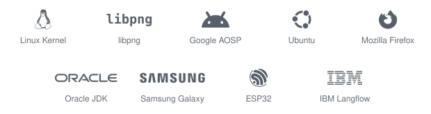

<h1 align="center">Taegu Ha</h1>

  I dig into kernels, embedded systems, and applications to find vulnerabilities. 
  I build my own research tools, turn findings into working exploits, and contribute fixes upstream.

<!-- security-contribution-logos:start -->

  <strong>Security Contributor to</strong> 
  <picture>
    <source media="(max-width: 767px) and (prefers-color-scheme: dark)" srcset="./assets/brands/contributors-mobile-dark.svg">
    <source media="(max-width: 767px)" srcset="./assets/brands/contributors-mobile-light.svg">
    <source media="(prefers-color-scheme: dark)" srcset="./assets/brands/contributors-desktop-dark.svg">
    
  </picture>

<!-- security-contribution-logos:end -->

  <a href="mailto:hataegu0826@gmail.com">Email</a> ·
  <a href="https://github.com/foxirain/CVE-public">CVE archive</a> ·
  <a href="https://dreamhack.io/users/71306">Dreamhack</a> ·
  <a href="./README.ko.md">한국어</a>

## Experience

- **CASO Lab, Kangwon National University** · Undergraduate Research Intern  
  Computer Architecture · Artificial Intelligence · Security · Operating System  
  May 2024 – Jan 2025
- **WhiteHat School, KITRI** · Cohort 2  
  Mar – Sep 2024

## Highlights

**2026**

- Authored **3 patches merged into Linux mainline**, fixing USB UAC1, PPP, and BPF verifier issues. [UAC1](https://git.kernel.org/pub/scm/linux/kernel/git/torvalds/linux.git/commit/?id=6e0e34d85cd46ceb37d16054e97a373a32770f6c) · [PPP](https://git.kernel.org/pub/scm/linux/kernel/git/torvalds/linux.git/commit/?id=2bb6379416fd19f44c3423a00bfd8626259f6067) · [BPF](https://git.kernel.org/pub/scm/linux/kernel/git/torvalds/linux.git/commit/?id=de36adca634634c205a9eb8b56a28175ab7abf5f)  
  For USB UAC1, developed an exploit chaining **CVE-2026-31720** with CVE-2026-31513 to bypass **SSP and KASLR** and achieve **root command execution** in x86-64 QEMU/KVM. [Exploit report](https://github.com/foxirain/CVE-public/tree/main/cases/CVE-2026-31720/exploit)
- Discovered **CVE-2026-33636** in **libpng**, rated **Critical** in Google’s Android Security Bulletin. Co-authored the security patch shipped in **libpng 1.6.56** and integrated into **Google AOSP, Ubuntu, and Firefox**. The fix also shipped in **Oracle JDK and Samsung Galaxy** updates. Listed in libpng’s **AUTHORS**. [CVE-2026-33636](https://github.com/foxirain/CVE-public/tree/main/cases/CVE-2026-33636) · [libpng](https://github.com/pnggroup/libpng/commit/aba9f18eba870d14fb52c5ba5d73451349e339c3) · [Android bulletin](https://source.android.com/docs/security/bulletin/2026/2026-09-01) · [AOSP](https://android.googlesource.com/platform/external/libpng/+/7d98050ef8d9d17d495eb178b8217548437cedf1) · [Firefox](https://github.com/mozilla-firefox/firefox/blob/53cc4f2877a561606f99d20aafc56e35a395f1e2/media/libpng/CHANGES#L6345-L6347) · [Oracle JDK](https://www.oracle.com/security-alerts/cpujul2026.html#AppendixJAVA) · [Samsung](https://security.samsungmobile.com/securityUpdate.smsb) · [Ubuntu](https://ubuntu.com/security/CVE-2026-33636) · [AUTHORS](https://github.com/pnggroup/libpng/blob/libpng16/AUTHORS)
- Reported **4 vulnerabilities, including 3 Critical**, across AI products (PraisonAI and Langflow). [PraisonAI A2A](https://github.com/foxirain/CVE-public/tree/main/cases/CVE-2026-47391) · [PraisonAI CI](https://github.com/foxirain/CVE-public/tree/main/cases/CVE-2026-48168) · [Langflow Policies](https://github.com/foxirain/CVE-public/tree/main/cases/CVE-2026-9135) · [Langflow Agentic Assistant](https://github.com/foxirain/CVE-public/tree/main/cases/CVE-2026-9196)
- Reported vulnerabilities in **ESP32 NBNS** and **Apache NimBLE ATT**, published as [CVE-2026-41429](https://github.com/foxirain/CVE-public/tree/main/cases/CVE-2026-41429) and [CVE-2026-45815](https://github.com/foxirain/CVE-public/tree/main/cases/CVE-2026-45815).  
  For ESP32, developed a **network-only exploit chain on physical ESP32-S3 hardware**, combining CVE-2026-41429 with CVE-2024-30166 to bypass stack protection and demonstrate **FreeRTOS task execution and 1,440-byte firmware memory disclosure**. [Physical exploit](https://github.com/foxirain/CVE-public/tree/main/cases/CVE-2026-41429/exploit)
- **GW TakeDown** · Galaxy Watch firmware security research. **Samsung Mobile Security approved a reward for one report**.  
  Designed and built [RehostRace](https://github.com/foxirain/rehostrace) and [VeriRehost](https://github.com/foxirain/verirehost) for firmware rehosting, execution replay, and analysis of verification flows.
- Received the **maximum reward** from **DenchiSoft’s bug bounty program** for reporting a security vulnerability (**$1,000**).
- Built [Adaptive Harness](https://github.com/foxirain/codex-adaptive-oss-vuln-harness) to score and rank source files using code signals, Git history, and external evidence, then run multiple search strategies and reallocate each session’s remaining investigation budget based on review results and cost. Built [Agent Security Company](https://github.com/foxirain/agent-security-company) to enforce per-agent filesystem and network permissions through Linux identities and sandbox policies, with separate QA agents verifying research results.

**2025**

- **Freelance Development** · Designed and delivered a **112-channel LED control system** for a psychology research lab, including custom hardware, Raspberry Pi 5 control software, and a 19-page operating manual.
- **Silver Award**, Student Division, Gangwon Cybersecurity Hacking Defense Competition (GCHD).
- Solved **154 Pwnable challenges** and reached an **overall Wargame rank in the 200s** on [Dreamhack](https://dreamhack.io/users/71306).

**2024**

- **GW5** · Reverse-engineered Galaxy Watch5 sensor drivers and SensorHub firmware; built AVB hash verification tools and a custom wired setup for firmware experiments.
- **WhiteGang** · Developed Windows user-mode and kernel-driver components for process protection, including DLL loading controls and handle-access restrictions. [PalAnticheat](https://github.com/foxirain/PalAnticheat) · [PalAnticheatEx](https://github.com/foxirain/PalAnticheatEx)
- **Council Chair's Award**, CO-SHOW AutoHack.

**2023**

- **Excellence Award**, Chuncheon Public Data Idea Competition.
