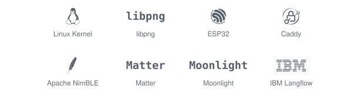

<h1 align="center">Taegu Ha</h1>

  I dig into kernels, embedded systems, and applications to find vulnerabilities. 
  I build my own research tools, turn findings into working exploits, and contribute fixes upstream.

<!-- security-contribution-logos:start -->

  <strong>Security Contributor to</strong> 
  <picture>
    <source media="(max-width: 767px) and (prefers-color-scheme: dark)" srcset="./assets/brands/contributors-mobile-dark.svg">
    <source media="(max-width: 767px)" srcset="./assets/brands/contributors-mobile-light.svg">
    <source media="(prefers-color-scheme: dark)" srcset="./assets/brands/contributors-desktop-dark.svg">
    
  </picture>

  <strong>Vulnerabilities Patched in</strong> 
  <picture>
    <source media="(max-width: 767px) and (prefers-color-scheme: dark)" srcset="./assets/brands/patched-mobile-dark.svg">
    <source media="(max-width: 767px)" srcset="./assets/brands/patched-mobile-light.svg">
    <source media="(prefers-color-scheme: dark)" srcset="./assets/brands/patched-desktop-dark.svg">
    
  </picture>

<!-- security-contribution-logos:end -->

  <a href="mailto:hataegu0826@gmail.com">Email</a> ·
  <a href="https://github.com/foxirain/CVE-public">CVE archive</a> ·
  <a href="https://dreamhack.io/users/71306">Dreamhack</a> ·
  <a href="./README.ko.md">한국어</a>

Credited upstream as Taegu Ha, foxirain, or Amemoyoi.

## Experience

- **CASO Lab, Kangwon National University** · Undergraduate Research Intern  
  Reverse-engineered Galaxy Watch5 sensor drivers and SensorHub firmware (GW5); built AVB hash verification tools and a custom wired setup for firmware experiments  
  May 2024 – Jan 2025
- **WhiteHat School, KITRI** · Cohort 2  
  Built Windows process-protection drivers in the WhiteGang team project  
  Mar – Sep 2024
- **st3p_up** · CTF Team  
  Pwnable and hardware security challenges at the Gangwon Cybersecurity Hacking Defense Competition (GCHD) and CO-SHOW AutoHack; awards in three consecutive years  
  2024 – Present
- **Tryangle** · AI and Backend Development  
  Scene-understanding model experiments and evaluation; server development, production deployment, and API security such as authentication and access control  
  Jul 2026 – Present
- **Freelance Development** · Commissioned by a psychology research lab  
  Designed and delivered a 112-channel LED control system, including custom hardware, Raspberry Pi 5 control software, and a 19-page operating manual  
  Jan – Feb 2025

## Highlights

### Vulnerability Research

- **Linux kernel** · Authored **3 patches merged into Linux mainline**, fixing USB UAC1, PPP, and BPF verifier issues.  
  The UAC1 and PPP fixes (**CVE-2026-31720**, **CVE-2026-53075**) were each backported to seven stable kernel series and shipped in Ubuntu, Debian, and SUSE security updates; the PPP fix also shipped in Red Hat Enterprise Linux 8–10.  
  For USB UAC1, developed an exploit chaining **CVE-2026-31720** with CVE-2026-31513 to bypass **SSP and KASLR** and achieve **root command execution** in x86-64 QEMU/KVM.  
  [UAC1](https://git.kernel.org/pub/scm/linux/kernel/git/torvalds/linux.git/commit/?id=6e0e34d85cd46ceb37d16054e97a373a32770f6c) · [PPP](https://git.kernel.org/pub/scm/linux/kernel/git/torvalds/linux.git/commit/?id=2bb6379416fd19f44c3423a00bfd8626259f6067) · [BPF](https://git.kernel.org/pub/scm/linux/kernel/git/torvalds/linux.git/commit/?id=de36adca634634c205a9eb8b56a28175ab7abf5f) · [Ubuntu](https://ubuntu.com/security/CVE-2026-53075) · [Debian](https://security-tracker.debian.org/tracker/CVE-2026-53075) · [Red Hat](https://access.redhat.com/security/cve/CVE-2026-53075) · [Exploit report](https://github.com/foxirain/CVE-public/tree/main/cases/CVE-2026-31720/exploit)
- **libpng** · Discovered **CVE-2026-33636**, rated **Critical** in Google’s Android Security Bulletin.  
  Co-authored the security patch shipped in **libpng 1.6.56** and integrated into **Google AOSP, Ubuntu, Debian, Red Hat, and Firefox**. The fix also shipped in **Oracle JDK and Samsung Galaxy** updates. Listed in libpng’s **AUTHORS**.  
  [CVE-2026-33636](https://github.com/foxirain/CVE-public/tree/main/cases/CVE-2026-33636) · [libpng](https://github.com/pnggroup/libpng/commit/aba9f18eba870d14fb52c5ba5d73451349e339c3) · [Android bulletin](https://source.android.com/docs/security/bulletin/2026/2026-09-01) · [AOSP](https://android.googlesource.com/platform/external/libpng/+/7d98050ef8d9d17d495eb178b8217548437cedf1) · [Firefox](https://github.com/mozilla-firefox/firefox/blob/53cc4f2877a561606f99d20aafc56e35a395f1e2/media/libpng/CHANGES#L6345-L6347) · [Oracle JDK](https://www.oracle.com/security-alerts/cpujul2026.html#AppendixJAVA) · [Samsung](https://security.samsungmobile.com/securityUpdate.smsb) · [Ubuntu](https://ubuntu.com/security/CVE-2026-33636) · [Debian](https://security-tracker.debian.org/tracker/CVE-2026-33636) · [Red Hat](https://access.redhat.com/security/cve/CVE-2026-33636) · [AUTHORS](https://github.com/pnggroup/libpng/blob/libpng16/AUTHORS)
- **AI products (PraisonAI and Langflow)** · Reported **4 vulnerabilities, including 3 Critical**.  
  [PraisonAI A2A](https://github.com/foxirain/CVE-public/tree/main/cases/CVE-2026-47391) · [PraisonAI CI](https://github.com/foxirain/CVE-public/tree/main/cases/CVE-2026-48168) · [Langflow Policies](https://github.com/foxirain/CVE-public/tree/main/cases/CVE-2026-9135) · [Langflow Agentic Assistant](https://github.com/foxirain/CVE-public/tree/main/cases/CVE-2026-9196)
- **ESP32 NBNS** · Reported a vulnerability, published as CVE-2026-41429.  
  For ESP32, developed a **network-only exploit chain on physical ESP32-S3 hardware**, combining CVE-2026-41429 with CVE-2024-30166 to bypass stack protection and demonstrate **FreeRTOS task execution and 1,440-byte firmware memory disclosure**.  
  [CVE-2026-41429](https://github.com/foxirain/CVE-public/tree/main/cases/CVE-2026-41429) · [Physical exploit](https://github.com/foxirain/CVE-public/tree/main/cases/CVE-2026-41429/exploit)
- **SentencePiece** (google/sentencepiece) · Found a heap out-of-bounds write and authored the merged fix. **Google Bug Hunters Honorable Mention**.  
  [SentencePiece #1211](https://github.com/google/sentencepiece/pull/1211) · [Honorable Mentions](https://bughunters.google.com/leaderboard/honorable-mentions?query=Taegu%20Ha)
- **Apache NimBLE ATT** · Reported a vulnerability, published as CVE-2026-45815.  
  [CVE-2026-45815](https://github.com/foxirain/CVE-public/tree/main/cases/CVE-2026-45815)
- **Caddy** · Authored two merged security fixes for remote admin access control; one is **CVE-2026-45692**.  
  [Caddy #7592](https://github.com/caddyserver/caddy/pull/7592) · [Caddy #7673](https://github.com/caddyserver/caddy/pull/7673) · [CVE-2026-45692](https://github.com/foxirain/CVE-public/tree/main/cases/CVE-2026-45692)
- **Moonlight** · Authored a merged fix hardening RTSP handling; reported a heap out-of-bounds write in H.264 SPS handling (**CVE-2026-41210**).  
  [Moonlight #134](https://github.com/moonlight-stream/moonlight-common-c/pull/134) · [CVE-2026-41210](https://github.com/foxirain/CVE-public/tree/main/cases/CVE-2026-41210)
- **Matter** (connectedhomeip) · Report credited in the fix.  
  [Matter #71708](https://github.com/project-chip/connectedhomeip/pull/71708)
- **libarchive** · Report credited in the fix.  
  [libarchive](https://github.com/libarchive/libarchive/commit/9082a50780f21855b238be3e3670110692042382)
- **VTube Studio** · Received the **maximum reward** from DenchiSoft’s **bug bounty program** for reporting a security vulnerability (**$1,000**). Listed in the **Security Hall of Fame**.  
  [Security Hall of Fame](https://github.com/DenchiSoft/VTubeStudio/wiki/Bug-Bounty-Program)

### Tool Development

- **GW TakeDown** · Galaxy Watch firmware security research.  
  Designed and built [RehostRace](https://github.com/foxirain/rehostrace) and [VeriRehost](https://github.com/foxirain/verirehost) for firmware rehosting, execution replay, and analysis of verification flows.
- **[Adaptive Harness](https://github.com/foxirain/codex-adaptive-oss-vuln-harness)** · Built to score and rank source files using code signals, Git history, and external evidence, then run multiple search strategies and reallocate each session’s remaining investigation budget based on review results and cost.
- **[Agent Security Company](https://github.com/foxirain/agent-security-company)** · Built to enforce per-agent filesystem and network permissions through Linux identities and sandbox policies, with separate QA agents verifying research results.
- **PalAnticheat** · Anti-cheat prototype for Palworld (WhiteHat School, 2024).  
  Developed Windows user-mode and kernel-driver components for process protection, including DLL loading controls and handle-access restrictions.  
  [PalAnticheat](https://github.com/foxirain/PalAnticheat) · [PalAnticheatEx](https://github.com/foxirain/PalAnticheatEx)

### Awards and Records

- 2026 · **Bronze Award**, Student Division, Gangwon Cybersecurity Hacking Defense Competition (GCHD).
- 2026 · **Encouragement Award**, Hanium Dreamup Competition (Tryangle).
- 2025 · **Silver Award**, Student Division, Gangwon Cybersecurity Hacking Defense Competition (GCHD).
- 2025 · Solved **154 Pwnable challenges** without LLM assistance and reached an **overall Wargame rank in the 200s** on [Dreamhack](https://dreamhack.io/users/71306).
- 2024 · **Council Chair's Award**, CO-SHOW AutoHack.
- 2023 · **Excellence Award**, Chuncheon Public Data Idea Competition.
